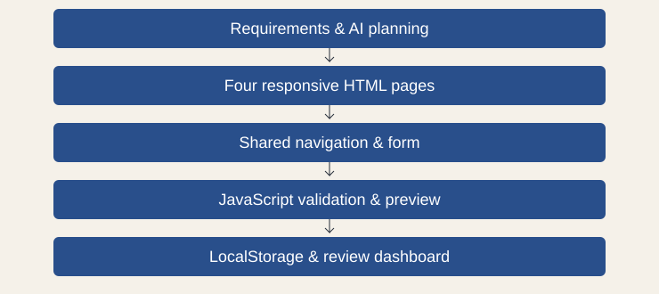

# StudentVoice — Experiment 04
**Khushi Jain Daga | 23bcon1665 | Web Development Using AI | VII semester**

## Aim
Create a multi-page website with navigation menu, forms, validation, and responsive layouts using AI-assisted development tools.

## Project
A fictional student academic feedback portal with four separate HTML pages, a shared navigation menu, course directory, validated review form and local review dashboard. No backend or real university affiliation. Use fictional details only; contact details are validated but not persisted.

## Tools
HTML5, CSS3 Grid/Flexbox, JavaScript, DOM API, regular expressions, FormData, localStorage. AI assistant: ChatGPT.

## Architecture

## Procedure
1. Define four pages and shared responsive shell.
2. Render searchable demo course directory and prefill selected course via URL parameters.
3. Validate identity, contact, course, two ratings, feedback length and declaration on the client.
4. Show inline errors, valid-field progress, character count and preview dialog.
5. Save non-contact review fields only after confirmation; read saved reviews to calculate averages and filter results.

## AI development brief
Build a responsive four-page student feedback portal in HTML/CSS/vanilla JS. Include meaningful navigation, real-time regex validation, accessible rating controls, review preview, local persistence and a searchable dashboard. Highlight student attribution on each page.

## Run
From this folder: `python -m http.server 8003` then open http://localhost:8003. No npm or API key needed. Use the same origin on every page.

## Testing checklist (manual browser verification pending)
- Navigate all four pages; check 360, 768 and 1440 px widths.
- Submit blank form; verify errors and focus on first invalid field.
- Enter malformed roll number, email and phone; verify rejection.
- Select two ratings, enter sufficient feedback and confirm declaration.
- Preview, edit and confirm a valid review; verify dashboard and reload persistence.
- Search, filter and delete a local review.
- Verify no name, roll, email or phone is stored in localStorage.

## Result
Source implements multi-page navigation and client-side form validation with a local feedback demonstration. Browser verification and genuine output screenshots are still required.
